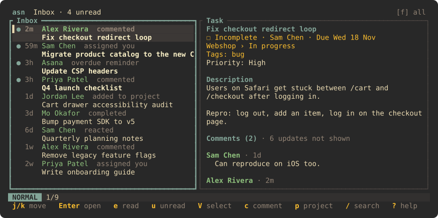
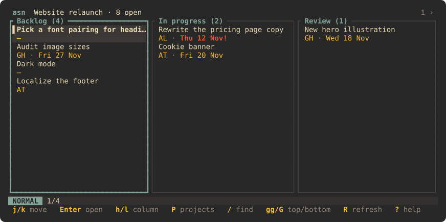

# asn

Your Asana Inbox and project boards in the terminal, with vim keys and a scriptable CLI.



## Why asn?

I built `asn` to get a simple terminal UI for the way I work with Asana:

- **The Inbox:** go through notifications, read the task, comment, and mark them read.
- **Projects as boards:** see where every task of a project stands, section by section, and act on any card.

The CLI is deliberately small as well. It covers the same use cases (`inbox`, `read`, `task`, `comment`, `desc`, `project add`, `project new`, `board`) and nothing more. For full access to the Asana API from the command line, use [Asana's own CLI](https://developers.asana.com/docs/asana-cli) (`npm install --global @asana-api/cli`).

> v0.2 adds project boards ([spec](docs/SPEC-board.md), [plan](tasks/plan.md)). v0.1 brought the Inbox, read state, task details, comments, description editing and adding to projects ([spec](docs/SPEC.md), [plan](tasks/v0.1/plan.md)).

## Install

With Homebrew (macOS or Linux):

```sh
brew tap lplotni/asn https://github.com/lplotni/asana-tui
brew install lplotni/asn/asn
```

Or download a binary for macOS (Apple Silicon, Intel) or Linux (x86_64, ARM) from [Releases](https://github.com/lplotni/asana-tui/releases), or build it with Rust:

```sh
cargo install --git https://github.com/lplotni/asana-tui
```

The release binaries aren't code-signed, so macOS blocks one downloaded in a browser. Allow it with `xattr -d com.apple.quarantine ./asn` (Homebrew and `cargo install` don't need this).

## Configure

Everything comes from the environment. Nothing is written to disk.

| Variable | |
|---|---|
| `ASANA_TOKEN` | A [personal access token](https://app.asana.com/0/my-apps) |
| `ASANA_TOKEN_CMD` | …or a command that prints it, e.g. `pass show asana/pat` |
| `ASANA_WORKSPACE` | Workspace GID (digits only): `curl -H "Authorization: Bearer $ASANA_TOKEN" https://app.asana.com/api/1.0/workspaces` |
| `ASN_SEARCH` | How `S` and `asn search` find tasks: `tasks` (default) uses Asana's full-text [task search](https://developers.asana.com/reference/searchtasksforworkspace) (names and descriptions; paid plans only); `typeahead` matches task names like the web search box and works on every plan |
| `ASN_THEME` | `terminal` (default, follows your terminal's colors), `dark`, `light`, or a path to a theme file ([example](themes/terminal.toml)) |
| `NO_COLOR` | Disables colors |

## Use

`asn` opens the Inbox. It shows the same notifications as the web Inbox, newest first, and the selected task's details: status, assignee, dates, projects, tags, custom fields, description, attachments and every comment with its emoji reactions. Image attachments are drawn inline with your terminal's graphics protocol (Kitty, iTerm2 or Sixel; colored half-blocks elsewhere). Below 100 columns it shows one pane at a time (`l`/`Enter` and `h`/`Esc` switch).

The bottom line always shows the keys that work in the current context, and `?` lists them all.

| Keys | |
|---|---|
| `j` `k` `gg` `G` `Ctrl-d` `Ctrl-u` | Move (with counts: `5j`, `12G`) |
| `l` / `Enter`, `h` / `Esc` | Focus the task (then the same keys scroll it) / back to the Inbox |
| `o` | Open the task in the browser |
| `c` (or `Tab c`) | Comment on the task in an editor overlay: `Ctrl-s` posts, `Esc` cancels (the text is kept for the next `c`), `Ctrl-o` continues in your `$EDITOR`; posting marks the task's notifications read |
| `Tab e` | Edit the description as plain text in the same overlay (`Ctrl-s` saves); asks first if it has formatting, which plain text removes |
| `p` (or `Tab p`) | Add the task to a project: type to search, `Ctrl-n`/`Ctrl-p` to move, `Enter` to choose, then pick a section |
| `m` | Move the task to another section: pick the project if it's in several, then the section (its current one is marked ✓; `j`/`k` or `Ctrl-n`/`Ctrl-p` move) |
| `e` / `u` / `x` | Mark read / unread / toggle (Asana's `E` and `U`) |
| `V` | Select a range, then `e` `u` `x` |
| `f` | Unread only / all |
| `R` | Refresh (also every 60 s) |
| `/` then `n` / `N` | Filter the loaded Inbox by actor, action or task name; `Enter` keeps it, `n`/`N` move through matches, `Esc` clears |
| `P` | Open a project's board: type to search projects (boards opened this session are listed first) |
| `b` | Open the board of the task's project, on that task (asks which project if it's in several) |
| `S` | Search tasks across the workspace (see `ASN_SEARCH`): type, `Ctrl-n`/`Ctrl-p` to move, `Enter` shows the task in the task pane, where `c`, `Tab e`, `p` and `o` work on it; `h`/`Esc` returns to the Inbox |
| `:` | Commands: `:q`, `:refresh`, `:unread`, `:read-all` (marks everything loaded read) |
| `?` | All keys (generated from the keymap) |
| `q` / `Ctrl-c` | Back (from the task pane or visual mode), else quit / quit from anywhere |

### Boards

`P` (or `asn --project <project-gid>`) opens a project as a board: one column per section, one card per open task with its assignee's initials and due date (`!` when overdue). When not every column fits, `h`/`l` page across them and the top line counts the hidden ones (`‹ 2  1 ›`). The board refreshes every 60 s.



| Keys | |
|---|---|
| `j` `k` `gg` `G` `Ctrl-d` `Ctrl-u` | Move within the column (with counts) |
| `h` / `l` | Previous / next column |
| `Enter` | Open the card's task full-width (`h`/`Esc`/`q` back) |
| `c`, `Tab e`, `p`, `m`, `o` | Comment, edit description, add to project, move to another section, open in browser, as in the Inbox; a moved card shows in its new column |
| `Tab q` | New task in this column: type its name, `Enter` creates it (unassigned, at the top of the column) and selects it, `Esc` cancels |
| `/` then `n` / `N` | Find cards by name across columns; `Esc` ends the search |
| `P` | Open another board; with nothing typed, `Enter` goes back to the last one |
| `Tab i` | Back to the Inbox, where you left it (boards keep their place too) |
| `R` | Refresh the board |

Every action is also a command for scripts:

```sh
asn inbox --unread                      # gid, unread marker, time, actor, action, task (tab-separated)
asn inbox --json | jq '.[0]'            # Asana's own JSON
asn inbox --unread | cut -f1 | xargs asn read      # mark everything read
asn search checkout redirect           # find tasks: gid, ✓ if completed, name (tab-separated; --json too)
asn task <task-gid>                     # a task with its description, attachments and comments (--json too)
asn comment <task-gid> -m 'Ship it'      # or `-` for stdin, or no text to open $EDITOR; prints the comment's gid
asn comment <task-gid> -m 'Thanks @1200000000000011'   # @<gid> mentions that person, task or project
asn users ada                           # people in the workspace: gid and name (tab-separated)
asn project add <task-gid> <project-gid> [--section <gid>]   # keeps the task's other projects
asn project sections <project-gid>      # a project's sections: gid and name (tab-separated)
asn project move <task-gid> <section-gid>    # move the task to another section of a project it's in
asn project new <project-gid> [--section <gid>] Write the launch post   # create an unassigned task; prints its gid
asn board <project-gid>                 # open tasks by section: section lines, then indented gid, name, assignee, due (--json too)
asn --project <project-gid>             # open the TUI on that project's board
asn desc <task-gid> [--file PATH | -] [--force]   # replace the description (plain text; --force for formatted ones)
```

`asn read --unread <gid>…` marks notifications unread. Exit codes: `0` ok, `1` error, `2` token problem.

## How it talks to Asana

`asn` uses Asana's public [REST API](https://developers.asana.com/reference/rest-api-reference) (v1.0, `https://app.asana.com/api/1.0`) over HTTPS with JSON, authenticated with your personal access token as a `Bearer` header. Every request asks only for the fields it shows (`opt_fields`), and lists are read page by page via `next_page.offset`.

| What | Endpoint |
|---|---|
| Inbox | `GET /users/me/notifications`, `POST /users/me/notifications/markRead` (and `markUnread`) |
| Task and description | `GET /tasks/{task}`, `PUT /tasks/{task}` |
| Comments and reactions | `GET /tasks/{task}/stories`, `POST /tasks/{task}/stories` (`html_text` when there's an @-mention, as for descriptions with `html_notes`) |
| People (`asn users`, @-mentions) | `GET /workspaces/{workspace}/typeahead?resource_type=user` |
| Attachments | `GET /attachments?parent={task}` |
| Task search (`S`, `asn search`) | `GET /workspaces/{workspace}/tasks/search`, or `GET /workspaces/{workspace}/typeahead?resource_type=task` with `ASN_SEARCH=typeahead` |
| Add to project | `GET /workspaces/{workspace}/typeahead`, `GET /projects/{project}/sections`, `POST /tasks/{task}/addProject` |
| Move to a section | `GET /projects/{project}/sections`, `POST /sections/{section}/addTask` |
| New task (`asn project new`) | `POST /tasks`, then `POST /sections/{section}/addTask` |
| Boards (`P`, `b`, `asn board`) | `GET /projects/{project}`, `GET /projects/{project}/sections`, `GET /projects/{project}/tasks?completed_since=now`; projects are found with `GET /workspaces/{workspace}/typeahead` |
| Images | the attachment's short-lived `download_url`, fetched from the file host without your token |

The Asana web app runs on its own internal API, so it can show things the public API can't; those gaps are listed below.

## Known limitations

These come from Asana's public API (most from the [Notifications API](https://forum.asana.com/t/new-notifications-api/1159934)), not from `asn`:

- **No archive.** The API can only mark notifications read or unread. `e` marks an item read, and it stays in the list, unlike `E` in the web Inbox, which removes it. Archive in the web app if you want an item gone: archived items disappear from `asn` at its next refresh.
- **No grouping.** The web Inbox can bundle several notifications about one task into one card; `asn` lists them one by one.
- **Polling, not push.** There are no webhooks for notifications, so new items appear on refresh (`R` or every 60 s).
- **Descriptions are edited as plain text.** Saving replaces Asana's formatting (links, lists, bold, mentions); `asn` asks first when a description has any. Edit formatted descriptions on the web.
- **Mentions look like comments.** The API doesn't mark @mentions separately.
- **Some tasks' comments can't be loaded.** For some tasks (likely those with replies to comments), Asana refuses the comment list with "unsupported parent in the public API: CommentStory". `asn` still shows the rest of the task and says why the comments are missing; read them on the web.
- **Task search needs a paid plan.** On other plans Asana answers 402; set `ASN_SEARCH=typeahead` to search task names instead. Results are the 50 most relevant, and new or renamed tasks can take up to a minute to become searchable.
- **Boards show open, top-level tasks only.** Completed tasks and subtasks aren't on the board, and cards can't be reordered within a column; `m` moves them between sections.
- **Image links expire.** An attachment's `download_url` works for a short time only; if an image fails after the task was open a while, refresh (`R`).

## Develop

```sh
cargo test
cargo run --example screenshot > docs/screenshot.svg            # regenerate the screenshots (made-up data)
cargo run --example screenshot -- board > docs/board.svg
```

Releases: push a `v*` tag. CI builds the four binaries, attaches them to a GitHub release, and commits the updated `Formula/asn.rb`.

## License

[MIT](LICENSE)
