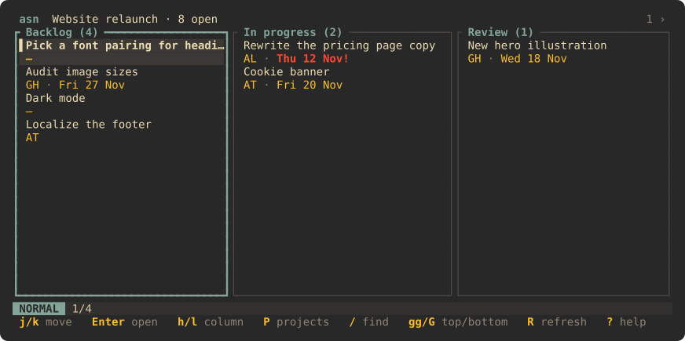
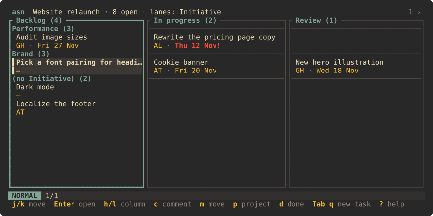

# Using the TUI

[asn](../README.md) › Using the TUI

## The Inbox

`asn` opens the Inbox. It shows the same notifications as the web Inbox, newest first, and the selected task's details: status, assignee, dates, projects, tags, custom fields, description, attachments and every comment with its emoji reactions; @-mentions show as names (`@Ada Lovelace`), not as Asana links. Image attachments are drawn inline with your terminal's graphics protocol (Kitty, iTerm2 or Sixel; colored half-blocks elsewhere). Below 100 columns it shows one pane at a time (`l`/`Enter` and `h`/`Esc` switch).

The bottom line always shows the keys that work in the current context, and `?` lists them all.

| Keys | |
|---|---|
| `j` `k` `gg` `G` `Ctrl-d` `Ctrl-u` | Move (with counts: `5j`, `12G`) |
| `l` / `Enter`, `h` / `Esc` | Focus the task (then the same keys scroll it) / back to the Inbox |
| `o` | Open the task in the browser |
| `d` | Mark the task complete (or incomplete again); `d` as the very next key undoes it |
| `Tab a` | Assign the task: `Me` and `Unassigned` come first, typing searches people |
| `c` (or `Tab c`) | Comment on the task in an editor overlay: `Ctrl-s` posts, `Esc` cancels (the text is kept for the next `c`), `Ctrl-o` continues in your `$EDITOR`; posting marks the task's notifications read. Typing `@` mentions someone: type part of a name, `Enter` inserts it (people, projects and tasks; `Esc` types a plain `@`) |
| `Tab e` | Edit the description as plain text in the same overlay (`Ctrl-s` saves), with `@` mentions as in comments; mentions already in it show as names and are kept. Asks first if it has other formatting (links, lists, bold), which plain text removes |
| `p` (or `Tab p`) | Add the task to a project: type to search, `Ctrl-n`/`Ctrl-p` to move, `Enter` to choose, then pick a section |
| `m` | Move the task to another section: pick the project if it's in several, then the section (its current one is marked ✓; `j`/`k` or `Ctrl-n`/`Ctrl-p` move) |
| `e` / `u` / `x` | Mark read / unread / toggle (Asana's `E` and `U`) |
| `V` | Select a range, then `e` `u` `x` |
| `f` | Unread only / all |
| `R` | Refresh now (it also happens every `refresh` seconds, 5 by default) |
| `/` then `n` / `N` | Filter the loaded Inbox by actor, action or task name; `Enter` keeps it, `n`/`N` move through matches, `Esc` clears |
| `P` | Open a project's board: type to search projects (boards opened this session are listed first) |
| `b` | Open the board of the task's project, on that task (asks which project if it's in several) |
| `S` | Search tasks across the workspace (see [`search`](configuration.md)): type, `Ctrl-n`/`Ctrl-p` to move, `Enter` shows the task in the task pane, where `c`, `Tab e`, `p` and `o` work on it; `h`/`Esc` returns to the Inbox |
| `:` | Commands: `:q`, `:refresh`, `:unread`, `:read-all` (marks everything loaded read) |
| `?` | All keys (generated from the keymap) |
| `q` / `Ctrl-c` | Back (from the task pane or visual mode), else quit / quit from anywhere |

## Boards

`P` (or `asn --project <project-gid>`) opens a project as a board: one column per section, one card per open task with its assignee's initials and due date (`!` when overdue). When not every column fits, `h`/`l` page across them and the top line counts the hidden ones (`‹ 2  1 ›`). The board refreshes with the rest of `asn`: every 5 s while the terminal is in front (see [Refresh and rate limits](configuration.md#refresh-and-rate-limits)).

**Swimlanes.** `v` splits the board into lanes by a single-select field such as Initiative: one lane per option (in the field's order, then the cards without one), each with the board's sections as columns, lined up across lanes. `v` again goes to the board's next single-select field (Initiative first), then back to columns; each board remembers its layout for the session. In lanes, `j`/`k` continue into the next or previous lane, and `Tab q` creates the task in that lane.

`F` sets a single-select field of the selected task, on a board or in the Inbox: choose the field (in lanes it starts with the lane field), then an option or `(none)`. On a board the card moves to its new lane.

| Keys | |
|---|---|
| `j` `k` `gg` `G` `Ctrl-d` `Ctrl-u` | Move within the column (with counts) |
| `h` / `l` | Previous / next column |
| `Enter` | Open the card's task full-width (`h`/`Esc`/`q` back) |
| `c`, `Tab e`, `p`, `m`, `o` | Comment, edit description, add to project, move to another section, open in browser, as in the Inbox; a moved card shows in its new column |
| `d` | Complete the card: it's struck through and leaves the column (at once with `animations = false`); `d` as the very next key reopens it |
| `Tab a` | Assign the card (its initials change once the board reloads) |
| `Tab q` | New task in this column (and lane): type its name, `Enter` creates it (unassigned, at the top of the column) and selects it, `Esc` cancels |
| `v` | Columns, then lanes by each single-select field, then columns again |
| `F` | Set a single-select field (e.g. Initiative) of the card |
| `/` then `n` / `N` | Find cards by name across columns; `Esc` ends the search |
| `P` | Open another board; with nothing typed, `Enter` goes back to the last one |
| `Tab i` | Back to the Inbox, where you left it (boards keep their place too) |
| `R` | Refresh the board |

Every action is also a [CLI command](cli.md) for scripts.
